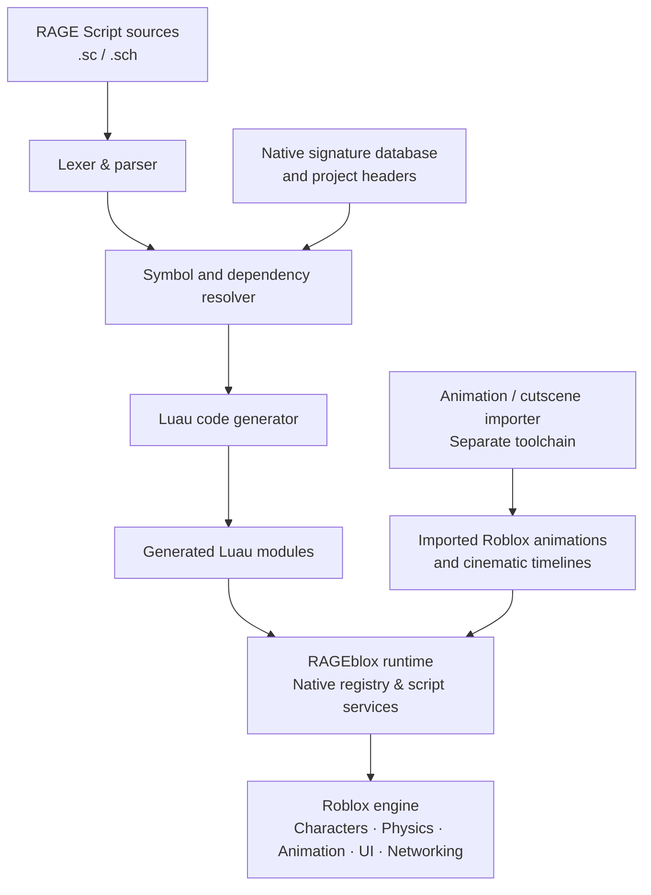
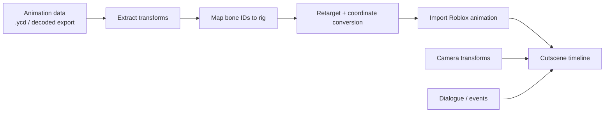

🎮 RAGEblox
A RAGE-inspired scripting compatibility layer and toolchain for Roblox
Translate supported RAGE Script concepts into Luau. Recreate gameplay systems using Roblox's engine. Experiment with cinematic animation pipelines.

Vision · Architecture · Features · Cutscenes · Roadmap · Contributing

[!IMPORTANT]
RAGEblox is a proposed independent, experimental project—not a working GTA V port. This README describes the intended design and milestones. The compiler, runtime APIs, and import pipeline below are illustrative, not documented as implemented features.

✨ Vision
RAGEblox aims to explore how concepts from Rockstar's RAGE scripting environment could be represented in Roblox Luau.

Rather than attempting to run the RAGE engine itself, the project would use Roblox for rendering, physics, animation, networking, and world simulation, while providing familiar gameplay APIs for entities, peds, cameras, missions, and cutscenes.

The longer-term experiment is a source-to-source compiler that accepts supported .sc / .sch syntax and generates Luau targeting the RAGEblox runtime.
Goals
- 🧩 RAGE-style native API — expose familiar functions backed by Roblox systems.
- 🦴 Character and animation support — coordinate rigged peds, tasks, and animation tracks.
- 🎥 Cinematic sequences — synchronise cameras, actors, props, dialogue, and events.
- 🧠 Script translation — parse supported RAGE Script syntax instead of relying on regex substitutions.
- 📦 Roblox-friendly output — generate Luau modules and eventually a Rojo-compatible project tree.
- 🔍 Transparent diagnostics — identify unresolved headers, globals, natives, and unsupported constructs.
Non-goals
- Running Rockstar's proprietary engine or executable binaries inside Roblox.
- Automatically recreating GTA V by converting scripts alone.
- Promising 1:1 rendering, physics, networking, or animation behaviour.
- Circumventing Roblox's restrictions on custom GPU shaders or executable native code.
🏗️ Architecture

The architecture has three distinct pieces:
Component	Technology	Responsibility
RAGE Script compiler	Rust (planned)	Tokenise, parse, resolve symbols, and emit Luau
RAGEblox runtime	Luau (planned)	Map supported native-style calls to Roblox services
Asset/animation pipeline	External tooling + Roblox Studio (research)	Import compatible rigs, animations, and cutscene timing

[!NOTE]
A native database describes the signatures of functions; it does not provide their Roblox implementations. Each engine-dependent behaviour must be adapted and tested independently.

⚙️ Planned features
Subsystem	Scope	Status
Lexer and parser	.sc/`.sch`, functions, expressions, conditionals	📝 Planned
Header resolver	Ordered USING dependencies, symbols and globals	📝 Planned
Luau emitter	Modules, types, diagnostics, source mapping	📝 Planned
Native registry	Supported API handlers and missing-native reporting	📝 Planned
Entity manager	Stable handles for models, parts and NPCs	📝 Planned
Ped/task manager	Movement, following, health and animation playback	📝 Planned
Vehicle manager	Spawning, ownership and entry/exit tasks	🔭 Future
World/graphics adapter	Lighting, atmosphere, weather and PBR presets	🔭 Future
Mission runtime	Shared state, triggers and objective scheduling	🔭 Future
Cutscene timeline	Actors, props, cameras and dialogue synchronisation	🔭 Future
.ycd animation research	Decode/import keyframes and map GTA skeleton IDs	🔬 Research

Legend: 📝 planned · 🔬 research · 🔭 future. These statuses do not imply the subsystem has been built.
🧱 Proposed repository structure
RAGEblox/
├── README.md
├── docs/
│   ├── architecture.md
│   ├── native-mappings.md
│   ├── scripting-language.md
│   └── animation-pipeline.md
├── compiler/                  # Rust source-to-source compiler (planned)
│   ├── src/
│   │   ├── lexer/
│   │   ├── parser/
│   │   ├── semantic/
│   │   ├── resolver/
│   │   └── codegen/
│   └── tests/
├── runtime/                   # Luau compatibility layer (planned)
│   ├── NativeRegistry.luau
│   ├── EntityManager.luau
│   ├── PedManager.luau
│   ├── TaskManager.luau
│   ├── CameraManager.luau
│   ├── CutsceneManager.luau
│   └── WorldManager.luau
├── tools/
│   └── animation-importer/    # Planned .ycd research and conversion
├── examples/
│   ├── basic-ped/
│   └── cinematic-scene/
└── tests/
This tree is a suggested design, not a claim that these files already exist.
🛠️ RAGE Script compiler
A key objective is a real parser-based compiler, not just a text-replacement script.
Example source
FUNC BOOL IS_SKYSWOOP_AT_GROUND()
    IF GET_SKYSWOOP_STAGE() = SKYSWOOP_NONE
        RETURN TRUE
    ENDIF
    RETURN FALSE
ENDFUNC
Illustrative Luau output
local RAGE = require(game.ReplicatedStorage.RAGEblox)

local function IS_SKYSWOOP_AT_GROUND(): boolean
    return RAGE.GET_SKYSWOOP_STAGE() == RAGE.SKYSWOOP_NONE
end

return {
    IS_SKYSWOOP_AT_GROUND = IS_SKYSWOOP_AT_GROUND,
}
Here, RAGE.GET_SKYSWOOP_STAGE and RAGE.SKYSWOOP_NONE are hypothetical runtime members. Generated Luau can only execute correctly once those dependencies are implemented.
Target language coverage
RAGE syntax	Planned translation
FUNC / PROC	Luau functions
IF / ELIF / ENDIF	if / elseif / end
WHILE, loop constructs	Luau loops, where semantics are understood
INT, BOOL, FLOAT	Luau values and optional type annotations
STRUCT, ENUM	Typed tables/constants or equivalent representations
USING "...sch"	Resolved dependencies, preserving required ordering
Native calls	Runtime calls or explicit unresolved-native diagnostics
Global data	Explicit shared state with defined lifetime and replication rules

A separate C/C++ frontend may be explored later. C/C++ is not the same language as RAGE Script and requires its own parser and semantics.
Example future CLI
# Proposed interface — this command does not exist yet.
rageblox compile path/to/example.sc --out build/
🎮 RAGEblox runtime
The runtime would expose GTA-style operations while using Roblox services behind the scenes.
Proposed API	Possible Roblox-backed behaviour
DOES_ENTITY_EXIST	Check whether an entity handle resolves to a live Instance
GET_ENTITY_COORDS	Read a Model pivot or BasePart position
SET_ENTITY_COORDS	Move a model or part, subject to authority and physics rules
GET_ENTITY_HEALTH	Read a Humanoid or custom health component
NETWORK_IS_PLAYER_ACTIVE	Query current Roblox server player membership
TASK_GO_TO_COORD	Use navigation/pathfinding with retry and failure states
STAT_GET_INT	Read a validated stats record
STAT_SET_INT	Authoritative server-side write with optional persistence

Not every GTA native has a direct Roblox equivalent. Unsupported features should return clear diagnostics, never silently pretend to work.
Example future runtime API
-- Illustrative API only — not yet implemented.
local RAGE = require(game.ReplicatedStorage.RAGEblox)

local ped = RAGE.CREATE_PED("TestPed", 0, 5, 0)
RAGE.SET_ENTITY_HEALTH(ped, 200)
RAGE.TASK_GO_TO_COORD(ped, 50, 5, 20)
For multiplayer experiences, authoritative actions such as spawning entities or changing health must be validated and performed on the server.
🎬 Cutscene & animation pipeline
One of RAGEblox's most exciting research goals is to reconstruct multi-actor cinematic sequences from compatible source animation data.
Example research asset
We examined an XML representation of a .ycd animation dictionary containing eight synchronised clips, including:
Clip	Intended subject
player_zero_dual-7	Michael
player_one_dual-7	Franklin
player_two_dual-7	Trevor
cs_davenorton_dual-7	Dave Norton
cs_stevehains_dual-7	Steve Haines
exportcamera-7	Cinematic camera
dinghy-7	Boat
prop_cs_pebble-7	Prop

The clip metadata describes 390 frames over roughly 12.97 seconds (about 30 FPS).

Current limitation: The examined XML exposed clip names, track references and bone IDs, but not usable transform keyframes in its empty sequence entries. That is not sufficient to reproduce the motion.
Proposed import workflow

The eventual timeline system could coordinate:
- Skeletal and facial animations where supported.
- Camera movement, cuts, depth of field and framing.
- Actor placement and scene props.
- Subtitles, audio cues and scripted events.
- Skip, pause, recovery and clean-up behaviour.
First cinematic milestone
A single scene with one rigged character, one imported animation, one animated camera, and a shared timeline. More complex scenes come afterwards.
🌤️ Graphics and shaders
RAGEblox could reproduce some of the visual style of GTA-like games using supported Roblox functionality:
- Lighting, Atmosphere, BloomEffect, ColorCorrectionEffect, and SunRaysEffect.
- SurfaceAppearance and PBR textures for suitable meshes.
- Weather and time-of-day presets.
- Custom meshes, particles and materials for selected visual effects.
[!WARNING]
Roblox does not provide general-purpose arbitrary HLSL/GLSL shader execution for normal experiences. Original PC shaders cannot simply be compiled and run inside Roblox. GPU debugging shaders from RenderDoc are not GTA V's game-rendering shaders.

🗺️ Roadmap
- [ ] Milestone 0 — Repository foundation: project layout, tests, diagnostics and documentation.
- [ ] Milestone 1 — Compiler prototype: lex/parse the sample .sch, emit valid Luau.
- [ ] Milestone 2 — Runtime v0.1: native registry, entity handles and basic ped tasks.
- [ ] Milestone 3 — First live test: create a character, set health, navigate and animate.
- [ ] Milestone 4 — Dependency resolution: ordered USING headers and shared globals.
- [ ] Milestone 5 — Animation import: one verified .ycd-derived clip retargeted to a Roblox rig.
- [ ] Milestone 6 — Cutscene prototype: synchronised character and camera timeline.
- [ ] Milestone 7 — Expanded native compatibility: stats, missions, vehicles and world systems.
- [ ] Milestone 8 — Project exporter: Rojo-ready generated output and sample experiences.
No milestone is marked complete until it has runnable code and a reproducible test.
🚀 Getting started
There is no installable release yet. This README is a project specification for an early-stage prototype.

When the first implementation is available, the intended workflow is:
1. Install Rust and Roblox Studio (and optionally Rojo).
2. Build the independent compiler from the compiler/ workspace.
3. Compile a small, authorised RAGE-style test source into Luau.
4. Add the RAGEblox runtime to an original Roblox Studio test place.
5. Run the generated module and inspect errors or unsupported-native diagnostics.
We will document exact build and test commands after those components exist.

Safety: The project should not require executing untrusted or proprietary Rockstar .exe tools. Source files and data can be inspected using independent tooling.
🤝 Contributing
Contributions will be especially helpful in:
- Parser correctness, expression handling and compiler diagnostics.
- Roblox entity, character, navigation and camera abstractions.
- Animation format research and retargeting tools.
- Automated tests using small, independently authored fixtures.
- Documentation, examples and performance profiling.
For an initial contribution:
1. Open an issue describing the feature or bug.
2. Explain the expected input, output and any limitations.
3. Keep compiler changes accompanied by syntax fixtures and expected results.
4. Include Roblox test steps for runtime changes.
5. Avoid committing proprietary game source, assets, credentials or suspicious executable binaries.
Suggested issue labels
compiler · runtime · natives · animation · cutscenes · graphics · documentation · good first issue
⚖️ Legal and compatibility notes
RAGEblox is an independent educational/experimental project. It is not affiliated with, endorsed by, or sponsored by Rockstar Games, Take-Two Interactive, or Roblox Corporation.
- RAGE, Grand Theft Auto, GTA V and related names and assets belong to their respective rights holders.
- Use only source code, models, textures, animations and other content you are authorised to use and distribute.
- The ability to extract or convert an asset does not grant permission to redistribute it or publish it on Roblox.
- The project should ship original code and test assets, not copyrighted game content.
- Compatibility is best-effort; no claim of complete or 1:1 GTA V support is made.
Licensing
License not selected yet. Choose a licence (for example, MIT or Apache-2.0) before accepting public contributions or distributing project code. Do not add a licence badge until the licence is actually included in the repository.

Built for experimentation. Designed for extensibility.
RAGE-style scripting × Luau × Roblox

Start with one function. Then one ped. Then one scene. Build the engine step by step.

